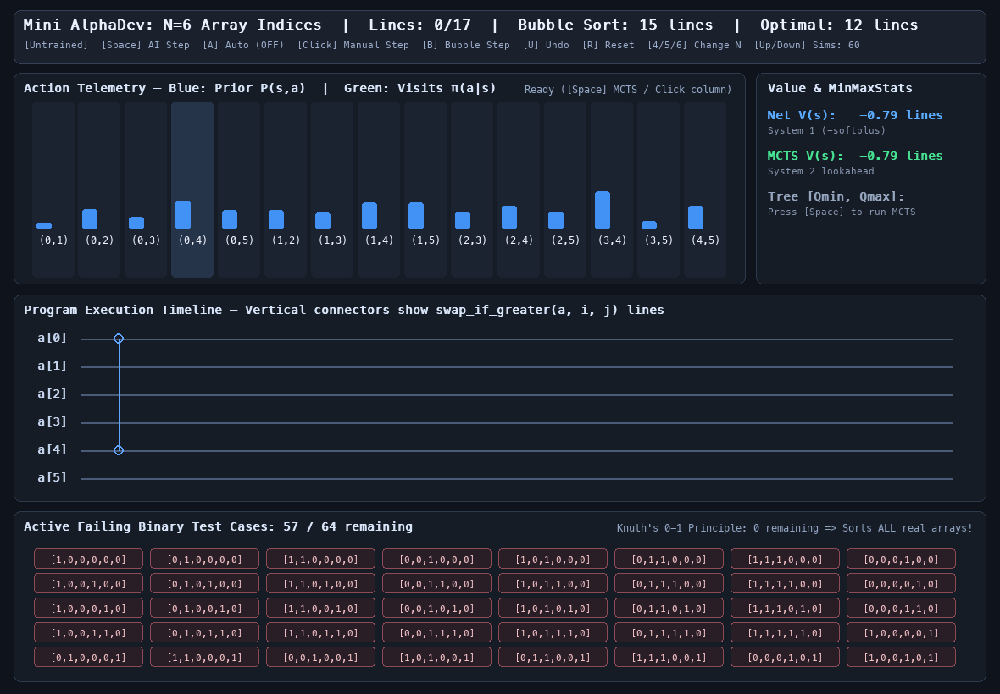
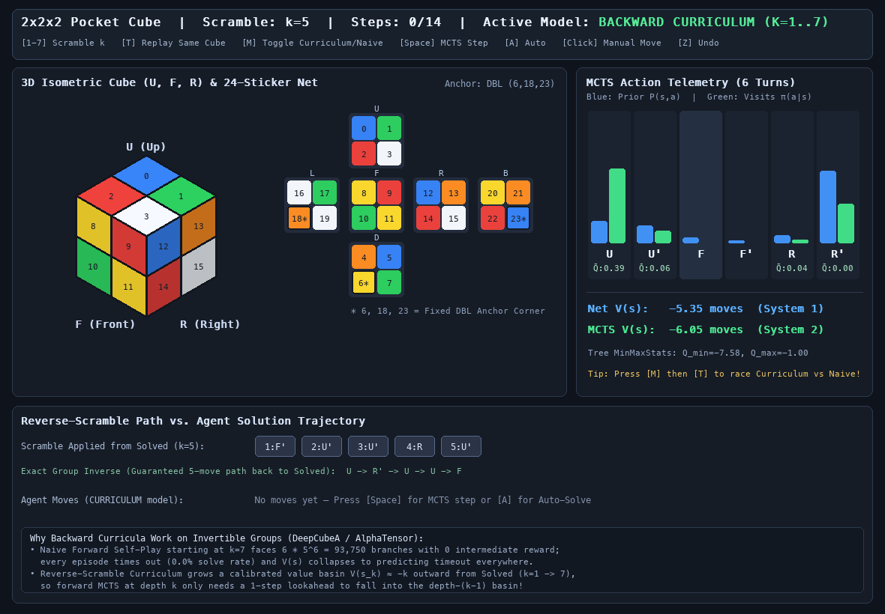

# Mini-AlphaDev: Single-Player AlphaZero for Program Synthesis

A small, from-first-principles single-player AlphaZero in **PyTorch** and **pygame-ce**, built to study the ideas behind AlphaDev / AlphaTensor-style discovery:

- **Min-max Q-normalization in PUCT**: no opponent and unbounded returns, so `Q(s, a)` is rescaled to `[0, 1]` across the current tree.
- **Cold start without self-play**: when there is no weaker copy of yourself to beat, random rollouts almost never reach a success.
- **Backward curricula**: grow the task outward from the solved state as the value head learns.

There are two tasks:

1. **Sorting programs (N = 4, 5, 6).** The agent writes a fixed-length program of `swap_if_greater(a, i, j)` statements (a sorting network). By the 0-1 principle, a program that sorts all `2^N` binary arrays sorts any array of N numbers. The state is the set of binary test cases that are still unsorted. Known optimal lengths are 5, 9 and 12 comparators.
2. **2x2x2 Pocket Rubik's Cube.** The same MCTS and network solve scrambles. This task compares *naive forward* training (always start at a deep scramble) with a *mastery-gated reverse-scramble backward curriculum*.



## Layout

| File | What it is |
| --- | --- |
| `env.py` | `SortingProgramEnv`: the action space is all `(i, j)` pairs, and the observation is the `2^N` failing-case mask plus `steps_taken / max_steps`. Uses precomputed lookup tables, so `step()` and legal-action checks are vectorized. |
| `mcts.py` | `SinglePlayerMCTS` with `MinMaxStats` Q-normalization, PUCT selection and no sign flip on backup. Includes a step-by-step generator that drives the visualizers. |
| `model.py` | `SortingProgramNet`: a dual-head residual MLP with LayerNorm, so batch-size-1 MCTS inference and minibatch training normalize the same way. |
| `train.py` | Self-play training for the sorting task (`--array-len`, `--iterations`, `--episodes`, `--sims`). Writes `sorting_n{N}_best.pt`. |
| `play.py` | Interactive visualizer for the sorting task: priors `P(s,a)` vs. visit counts `π(a|s)`, `V(s)` vs. MCTS value, the program timeline, and the live grid of failing binary cases. |
| `cube_env.py` | `PocketCubeEnv`: 24-sticker 2x2x2 cube with the DBL corner fixed and 6 quarter-turn actions (U, U', F, F', R, R'). |
| `cube_train.py` | `PocketCubeTrainer` in `naive` or `curriculum` mode, plus `--compare` for a head-to-head solve-rate table by scramble depth. |
| `cube_play.py` | Interactive cube visualizer. You can race the curriculum model against the naive model on the same scramble. |
| `*.pt` | Trained checkpoints: `sorting_n{4,5,6}_best.pt`, `cube_curriculum.pt`, `cube_naive.pt`. |

## Quickstart

```bash
uv sync

# Sorting-program visualizer (starts at N=4; press 4/5/6 to switch)
uv run python play.py

# Train the sorting agent
uv run python train.py --array-len 5 --iterations 6 --episodes 20 --sims 40

# Pocket cube visualizer
uv run python cube_play.py

# Naive vs. backward-curriculum benchmark on the cube
uv run python cube_train.py --compare
```

Note: `train.py` and `cube_train.py` overwrite the bundled checkpoints of the same name.

### Visualizer controls

**`play.py`**: `[Space]` AI step · `[A]` auto · `[Click]` manual step · `[B]` bubble-sort step · `[U]` undo · `[R]` reset · `[4/5/6]` change N · `[Up/Down]` simulation count · `[Q]` quit

**`cube_play.py`**: `[1-7]` scramble depth · `[T]` replay same cube · `[M]` toggle curriculum/naive model · `[Space]` MCTS step · `[A]` auto-solve · `[Click]` manual move · `[Z]` undo · `[Q]` quit


